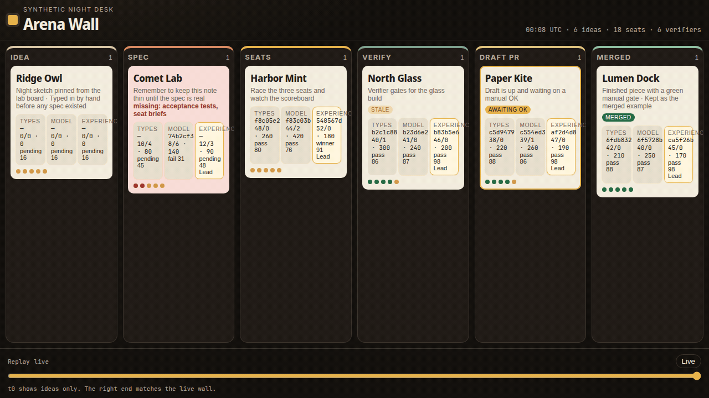
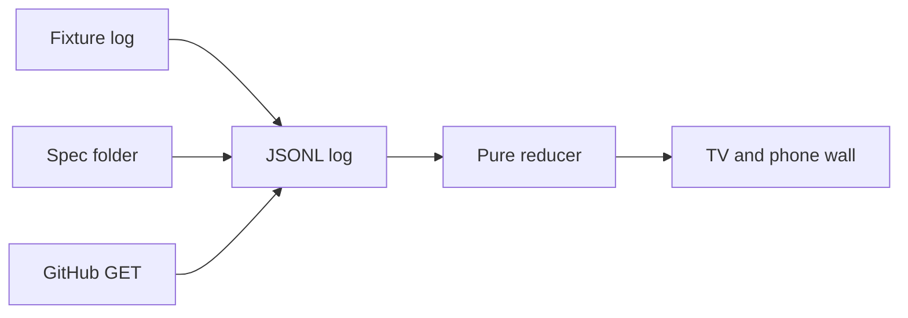
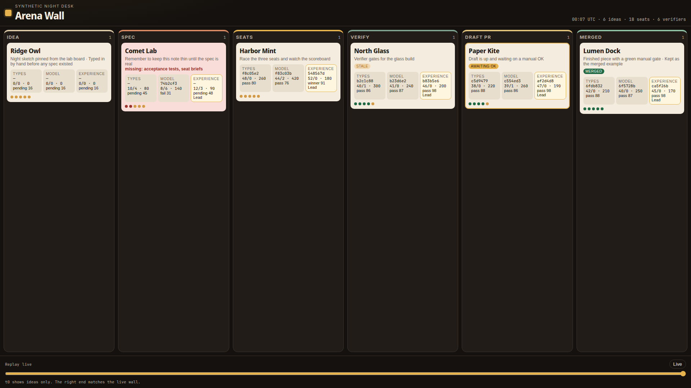
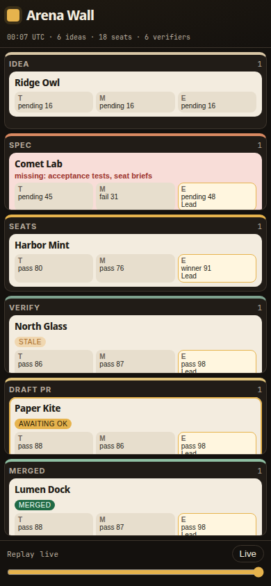
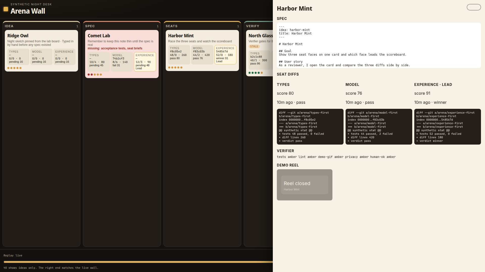

# Arena Wall

One read-only screen for the idea → spec → seats → verify → draft PR → merged pipeline. It folds events. It does not launch work, open a pull, or merge.



## Two-minute quickstart

One command:

```bash
npm install && npm start
```

Open [http://127.0.0.1:4317](http://127.0.0.1:4317). Phone layout: [http://127.0.0.1:4317/?mode=phone](http://127.0.0.1:4317/?mode=phone).

| Minute | What to do |
| --- | --- |
| 0:00 | The TV wall loads six synthetic ideas, one in each lane, with eighteen seat faces. |
| 0:30 | Comet Lab is red: `missing: acceptance tests, seat briefs`. Paper Kite wears a gold **Awaiting OK** badge. North Glass is stale. |
| 1:00 | Open **Harbor Mint**. The experience seat leads. The three diff stats sit side by side. |
| 1:20 | Open **North Glass**. The demo-reel gate is green, so the thumbnail is lit. |
| 1:40 | Drag **Replay** to the left. At t0 every card is in Idea and the later lanes are empty. **Live** jumps back. |
| 2:00 | Fix the weak note: `cp demos/comet-lab-fixed.md specs/comet-lab.md`. Comet Lab turns green and slides into Seats. Restore the weak note with `git checkout -- specs/comet-lab.md`. |

Lint a spec without starting the wall:

```bash
npx arena-wall lint fixtures/specs/valid-wall.md
```

## Architecture



| Path | Role |
| --- | --- |
| `sources/fixtures.ts` | Default day: 6 ideas, 18 seats, 6 verifiers. No env vars required. |
| `sources/specfs.ts` | Watches a folder of `SPEC.md` files and emits lint events. |
| `sources/github.ts` | Opt-in `GET` only: branches, pulls, check runs, `SPEC.md`. |
| `core/model.ts` | Domain types and the pure `reduce`. |
| `core/statechart.ts` | Allowed lane hops. Illegal hops flag and do not move. |
| `core/specLint.ts` | Spec gate: sections, acceptance tests, seat briefs, banned content. |
| `core/score.ts` | Seat scoreboard. Tests 40, types/model 20, UX 25, README and GIF 15. |
| `server/serve.ts` | Node HTTP and SSE. Static UI. No write routes. |
| `ui/` | Lanes, seat faces, detail drawer, replay slider, `?mode=phone`. |
| `cli/arena-wall.ts` | `serve`, `lint`, `snapshot`. |

Events append to `.arena-wall/events.jsonl`. State is the fold of that log. The replay slider is the same fold, truncated.

A card cannot enter Seats unless the latest spec report passed. Merged requires the `human-ok` gate to be green, and only a fixture or an observed check can set that. A seat with no update for 90 minutes is marked stale.

GitHub stays off unless all three are set: `ARENA_WALL_GITHUB=1`, `GITHUB_TOKEN`, and `ARENA_WALL_REPO`. The adapter never sends a request body.

## Commands

```bash
npx arena-wall serve
npx arena-wall lint path/to/SPEC.md
npx arena-wall snapshot --out shots/wall-tv.png --mode tv
npm test
```

`npm test` runs the unit suite and the Playwright screenshots at 1920×1080 and 390×844.

## Shots







Names in the fixture are synthetic: Ridge Owl, Comet Lab, Harbor Mint, North Glass, Paper Kite, Lumen Dock.
