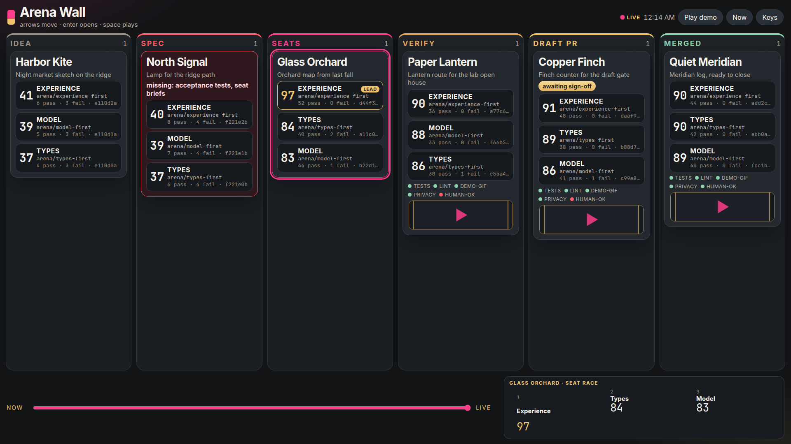
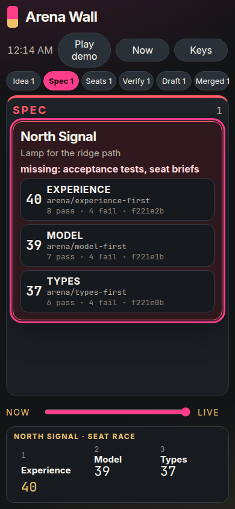
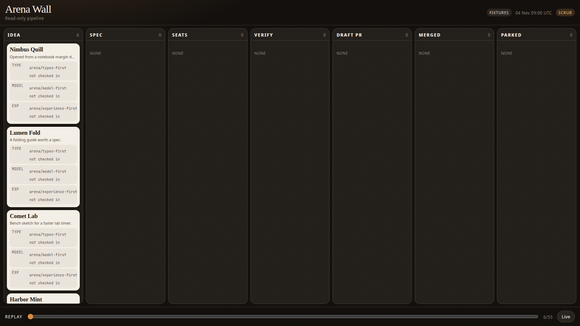
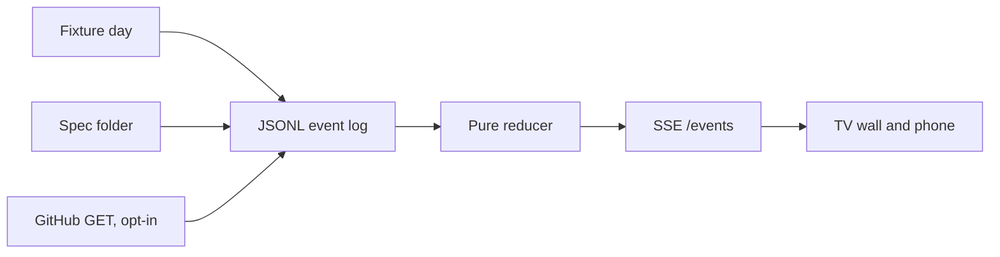

# Arena Wall

One screen for the path from idea to spec to arena seats to a draft pull request. It reads. It does not launch agents, and it does not merge.







## Two-minute quickstart

```bash
npm install
npm start
```

Open http://127.0.0.1:4177

That is the whole run. No token, no database, no network. The wall loads six synthetic builds, eighteen seat faces, and a replay of one day.

| Key | What it does |
| --- | --- |
| Space | Play the day, about twenty seconds |
| Arrows | Move between lanes |
| Enter | Open the spec, the three diffs, and the verifier |
| Esc | Close |
| `[` `]` | Step the replay |
| Home / End | Morning, or live |
| 1–6 | Jump to a lane |

Phone layout: http://127.0.0.1:4177/?mode=phone

Drop a markdown file into `specs/inbox/`. Within a second the card shows whether the spec can pass the gate. A weak file turns the card red and lists what is missing, for example `acceptance tests, seat briefs`.

Other commands:

```bash
npm test
npm run test:e2e
npx arena-wall lint sources/fixtures/specs/complete.md
npx arena-wall snapshot --out docs/screenshots/wall-1920.png
```

GitHub is off unless you opt in. Set `ARENA_SOURCE=github`, `GITHUB_TOKEN`, and `ARENA_REPO=owner/name`. The adapter sends GET requests only, and it never turns the sign-off gate green.

## Architecture



| Path | Role |
| --- | --- |
| `core/model.ts` | Types and the pure reducer |
| `core/statechart.ts` | Allowed lane edges |
| `core/specLint.ts` | Spec gate |
| `core/score.ts` | Seat scoreboard and the 40 / 20 / 25 / 15 rubric |
| `sources/fixtures` | Synthetic day: six ideas, eighteen seats, six verifiers |
| `sources/github` | Read-only adapter |
| `sources/specfs` | Dropped spec files |
| `server/host.ts` | Static host, GET and SSE only |
| `ui/` | The wall, the drawer, and the replay |
| `cli/arena-wall.ts` | `serve`, `lint`, `snapshot` |

State is a fold of events. The same events always produce the same state. A card moves only along the chart: Idea, Spec, Seats, Verify, Draft PR, Merged, plus Parked. Seats stay closed until the spec passes. Merged stays closed until the sign-off gate is green, and only a fixture can turn that gate green.

Notes on a few sketch mismatches are in [docs/spec-gaps.md](docs/spec-gaps.md).
