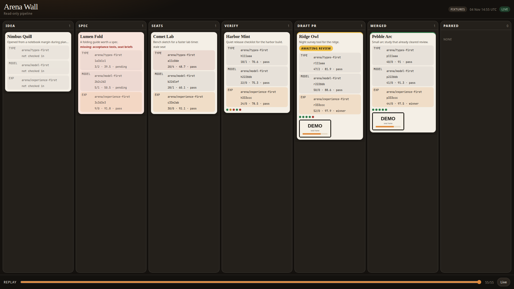
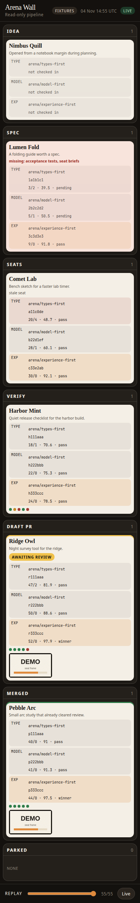
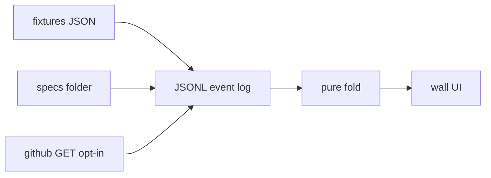

# Arena Wall

One read-only wall for the idea → spec → arena → verified draft pipeline. Every idea is a card. Every seat is a face. A spec gate holds a card out of the seats lane until the spec is whole.

The wall reads. It does not launch agents, and it does not merge.


## Quickstart

From a clean checkout, about two minutes:

```bash
npm install
npm start
```

Open [http://127.0.0.1:4173](http://127.0.0.1:4173). No token and no environment variables are required. The server seeds a synthetic log (6 ideas, 18 catalog seats, 6 catalog verifiers) and serves it.

Phone layout: [http://127.0.0.1:4173/?mode=phone](http://127.0.0.1:4173/?mode=phone).

Drag the replay slider to the left. That prefix is only idea cards. Drag it to the right and the wall matches the live fold. Click **Ridge Owl** for the spec, the three seat diffs, the verifier gates, and the demo frame.

To reset the local log: `rm -rf .arena-wall` and start again. `ARENA_RESET=1 npm start` reseeds on boot.

Drop a markdown file in `specs/` named after an idea id (`lumen-fold.md` is already the weak note). On save, the wall re-lints it. A whole spec with seat records already on the card slides into Seats.

## What you should see

| Card | Lane | Why |
| --- | --- | --- |
| Nimbus Quill | Idea | No spec yet. Three faces are still waiting |
| Lumen Fold | Spec | Red. `missing: acceptance tests, seat briefs` |
| Comet Lab | Seats | Experience-first leads. One seat is stale |
| Harbor Mint | Verify | Gates are mixed. No demo frame |
| Ridge Owl | Draft PR | Gold **awaiting review** badge and a demo frame |
| Pebble Arc | Merged | Human gate was green in the fixture before the merge event |
| — | Parked | Empty. The lane is real; this week nothing is parked |





## Architecture



```
sources/     read-only adapters: fixtures, specfs, github GET
core/        types, reducer, statechart, spec lint, score, replay
server/      Node HTTP + SSE, no framework
ui/          one page, TV and phone
cli/         arena-wall serve | lint | snapshot
docs/        lifecycle model, screenshots, demo gif
```

Events append to `.arena-wall/events.jsonl`. State is `fold(events)`. The same function serves the live wall and the replay slider, so a scrub cannot drift from the model.

The lifecycle is not copied into the code. `core/statechart.ts` loads the transition table in [docs/lifecycle.md](docs/lifecycle.md). [docs/Lifecycle.tla](docs/Lifecycle.tla) lists the same allowed pairs. `npm test` fails if those three disagree.

## Commands

```bash
npm test                 # unit, property, privacy, SSE
npm run test:e2e         # 1920×1080 and 390×844 screenshots, replay, drawer
npm run demo-director    # gif is non-blank and the deny scan is clean
npm run check            # all three

npx arena-wall lint sources/fixtures/specs/good-spec.md
npx arena-wall snapshot --out wall.png
```

GitHub is opt-in and GET-only:

```bash
ARENA_SOURCE=github GITHUB_TOKEN=... ARENA_REPO=owner/name npm start
```

If the token or repo is missing, the server stays on fixtures. There is no write route.

## Model notes

These are the places the implementation is more specific than the sketch, or had to step around a conflict:

- The waiting flag is `awaiting-ok`, and the badge says "awaiting review". The sketch's flag string contains a deny-listed given name, so that literal is not in the tree.
- `PipelineState` keeps the latest spec report. The sketch left it only on the event, and the gate has to survive a fold.
- Parked had no event. The model adds `idea.parked` and `idea.reopened`. They are local log events. The fixture week does not use them.
- `lintSpec` `ok` is structural: a goal heading, at least one acceptance item, and seat briefs that name `types-first`, `model-first`, and `experience-first`. Deny-list hits are warnings. The canonical spec passes structurally (10 acceptance tests) and warns, because its policy section names the deny list. That file is not in the repo; committing it would fail the privacy scan.
- Deny tokens are whole words. A substring search would flag the `statechart` module and ordinary words such as "service".
- The catalog JSON has 18 seats and 6 verifiers. The legal log admits 15 seats and 3 verifiers. Nimbus Quill has not reached a spec, so its three faces stay "not checked in".
- Stale means `updatedAt` is more than 90 minutes behind the log clock (the last applied event), not the laptop clock. Replay stays exact.
- A pull-request payload may say merged. The lane enters `merged` only when the `human-ok` gate is green. The process never sends a forge write.
- Seat rows can be stored while a card is still in Spec. Storage is not admission. Only `tryMove` changes a lane.
- Demo Director v1.1 is not a published package in this environment. `npm run demo-director` is the local check: the gif has duration, and the deny scan is clean.
