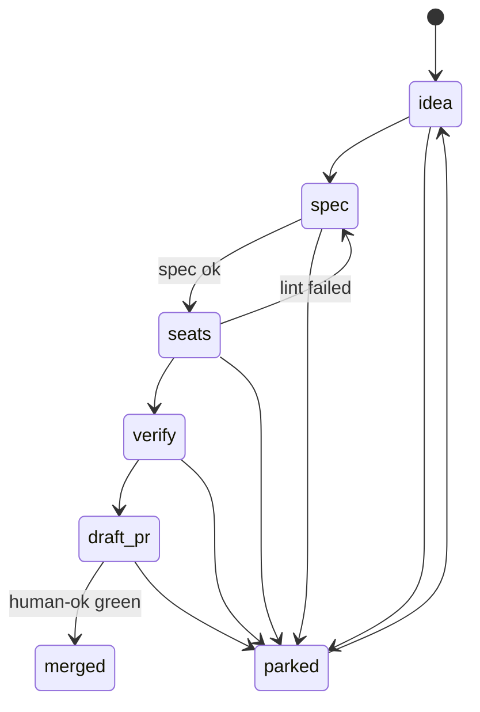

# Arena Wall lifecycle

This document is the model. `core/statechart.ts` loads the `transition-table` block below and does not keep a second copy. `docs/Lifecycle.tla` lists the same allowed pairs. A unit test fails if the code, this table, and the TLA spec disagree.

## States

A card is in exactly one lane:

| Lane | Meaning |
| --- | --- |
| idea | Captured, no spec admitted yet |
| spec | A spec report exists. The card stays here until the report is ok and a seat observation is admitted |
| seats | At least one seat was admitted through the spec gate |
| verify | A verifier observation was admitted from seats |
| draft_pr | A pull request was admitted from verify. The app does not open it |
| merged | Admitted only when the `human-ok` gate is green. The app never merges |
| parked | Withdrawn from the active pipeline. Terminal lanes do not park |

`merged` has no outgoing edge. Reopening is `parked → idea` only.

## Guards

Structural admission and guards are different:

- `spec → seats` is in the graph, and it fires only when the latest spec report has `ok: true`. If the report is not ok, the lane does not change and the card carries `spec-gate`.
- `draft_pr → merged` is in the graph, and it fires only when the verifier gate `human-ok` is green. Otherwise the lane stays `draft_pr`. The waiting flag is derived, not stored, so replay stays a pure fold.
- Every other disallowed pair is an `illegal-transition`. The lane and the records do not change. The flag is the only effect.

Observations are not admission. A `seat.updated` event may store a seat while the card is still in `spec` (the gate blocked admission). Storing the measurement does not move the lane. `tryMove` is the only lane writer.

## Flags

| Reason | When it appears |
| --- | --- |
| illegal-transition | `tryMove` was asked for a pair this table marks `allowed: false` |
| spec-gate | The latest spec report is not ok, or `spec → seats` was blocked |
| stale-seat | Derived at projection time: a seat `updatedAt` is more than 90 minutes behind the log clock |
| awaiting-ok | Derived at projection time: lane is `draft_pr` and `human-ok` is not green |

The log clock is the timestamp of the last applied event. Replay uses that same clock, so a scrub to an earlier index rewinds staleness too.

## Event mapping

| Event | Lane effect |
| --- | --- |
| `idea.added` | Birth at `idea` only. A repeated id is illegal and stores nothing new |
| `spec.linted` ok | `idea → spec`. If seat records already exist, continue `spec → seats` |
| `spec.linted` not ok | `idea → spec` or `seats → spec`, and `spec-gate` |
| `seat.updated` | Store the seat. From `spec`, attempt `spec → seats` |
| `verifier.updated` | Store the verifier. From `seats`, `seats → verify` |
| `pr.updated` draft | From `verify`, `verify → draft_pr` |
| `pr.updated` merged | From `verify`, step `verify → draft_pr` then `draft_pr → merged` if `human-ok` is green |
| `idea.parked` | Attempt `→ parked` |
| `idea.reopened` | Attempt `parked → idea` |

`idea.parked` and `idea.reopened` are model extensions. The event sketch has a parked lane and no event that reaches it.

## Invariants

- A card enters `seats`, `verify`, `draft_pr`, or `merged` only after an ok spec.
- A card enters `merged` only when `human-ok` is green at that step.
- `merged` is terminal.
- Folding the same log twice yields deep-equal state.
- Prefix `t0` is the opening run of `idea.added` events. That state contains only idea-lane cards.

## Replay

`fold(log, index)` reduces `log[0..index)` and projects flags at the prefix clock. Index `t0` shows only ideas. Index `log.length` is the live wall.

## Transition table

```transition-table
[
  {
    "from": "idea",
    "to": "idea",
    "allowed": true,
    "guard": "none"
  },
  {
    "from": "idea",
    "to": "spec",
    "allowed": true,
    "guard": "none"
  },
  {
    "from": "idea",
    "to": "seats",
    "allowed": false,
    "guard": "none"
  },
  {
    "from": "idea",
    "to": "verify",
    "allowed": false,
    "guard": "none"
  },
  {
    "from": "idea",
    "to": "draft_pr",
    "allowed": false,
    "guard": "none"
  },
  {
    "from": "idea",
    "to": "merged",
    "allowed": false,
    "guard": "none"
  },
  {
    "from": "idea",
    "to": "parked",
    "allowed": true,
    "guard": "none"
  },
  {
    "from": "spec",
    "to": "idea",
    "allowed": false,
    "guard": "none"
  },
  {
    "from": "spec",
    "to": "spec",
    "allowed": true,
    "guard": "none"
  },
  {
    "from": "spec",
    "to": "seats",
    "allowed": true,
    "guard": "spec-ok"
  },
  {
    "from": "spec",
    "to": "verify",
    "allowed": false,
    "guard": "none"
  },
  {
    "from": "spec",
    "to": "draft_pr",
    "allowed": false,
    "guard": "none"
  },
  {
    "from": "spec",
    "to": "merged",
    "allowed": false,
    "guard": "none"
  },
  {
    "from": "spec",
    "to": "parked",
    "allowed": true,
    "guard": "none"
  },
  {
    "from": "seats",
    "to": "idea",
    "allowed": false,
    "guard": "none"
  },
  {
    "from": "seats",
    "to": "spec",
    "allowed": true,
    "guard": "none"
  },
  {
    "from": "seats",
    "to": "seats",
    "allowed": true,
    "guard": "none"
  },
  {
    "from": "seats",
    "to": "verify",
    "allowed": true,
    "guard": "none"
  },
  {
    "from": "seats",
    "to": "draft_pr",
    "allowed": false,
    "guard": "none"
  },
  {
    "from": "seats",
    "to": "merged",
    "allowed": false,
    "guard": "none"
  },
  {
    "from": "seats",
    "to": "parked",
    "allowed": true,
    "guard": "none"
  },
  {
    "from": "verify",
    "to": "idea",
    "allowed": false,
    "guard": "none"
  },
  {
    "from": "verify",
    "to": "spec",
    "allowed": false,
    "guard": "none"
  },
  {
    "from": "verify",
    "to": "seats",
    "allowed": false,
    "guard": "none"
  },
  {
    "from": "verify",
    "to": "verify",
    "allowed": true,
    "guard": "none"
  },
  {
    "from": "verify",
    "to": "draft_pr",
    "allowed": true,
    "guard": "none"
  },
  {
    "from": "verify",
    "to": "merged",
    "allowed": false,
    "guard": "none"
  },
  {
    "from": "verify",
    "to": "parked",
    "allowed": true,
    "guard": "none"
  },
  {
    "from": "draft_pr",
    "to": "idea",
    "allowed": false,
    "guard": "none"
  },
  {
    "from": "draft_pr",
    "to": "spec",
    "allowed": false,
    "guard": "none"
  },
  {
    "from": "draft_pr",
    "to": "seats",
    "allowed": false,
    "guard": "none"
  },
  {
    "from": "draft_pr",
    "to": "verify",
    "allowed": false,
    "guard": "none"
  },
  {
    "from": "draft_pr",
    "to": "draft_pr",
    "allowed": true,
    "guard": "none"
  },
  {
    "from": "draft_pr",
    "to": "merged",
    "allowed": true,
    "guard": "human-ok"
  },
  {
    "from": "draft_pr",
    "to": "parked",
    "allowed": true,
    "guard": "none"
  },
  {
    "from": "merged",
    "to": "idea",
    "allowed": false,
    "guard": "none"
  },
  {
    "from": "merged",
    "to": "spec",
    "allowed": false,
    "guard": "none"
  },
  {
    "from": "merged",
    "to": "seats",
    "allowed": false,
    "guard": "none"
  },
  {
    "from": "merged",
    "to": "verify",
    "allowed": false,
    "guard": "none"
  },
  {
    "from": "merged",
    "to": "draft_pr",
    "allowed": false,
    "guard": "none"
  },
  {
    "from": "merged",
    "to": "merged",
    "allowed": true,
    "guard": "none"
  },
  {
    "from": "merged",
    "to": "parked",
    "allowed": false,
    "guard": "none"
  },
  {
    "from": "parked",
    "to": "idea",
    "allowed": true,
    "guard": "none"
  },
  {
    "from": "parked",
    "to": "spec",
    "allowed": false,
    "guard": "none"
  },
  {
    "from": "parked",
    "to": "seats",
    "allowed": false,
    "guard": "none"
  },
  {
    "from": "parked",
    "to": "verify",
    "allowed": false,
    "guard": "none"
  },
  {
    "from": "parked",
    "to": "draft_pr",
    "allowed": false,
    "guard": "none"
  },
  {
    "from": "parked",
    "to": "merged",
    "allowed": false,
    "guard": "none"
  },
  {
    "from": "parked",
    "to": "parked",
    "allowed": true,
    "guard": "none"
  }
]
```

## Statechart


